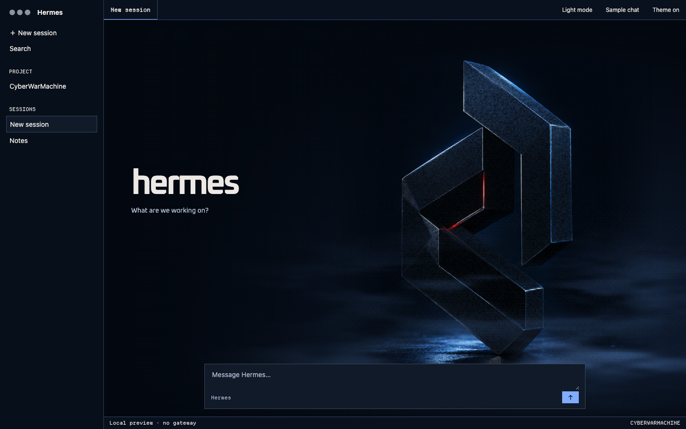

# CyberWarMachine for Hermes Desktop

A battle-worn monument, drifting blue ground haze, and one soft sweep of light across the steel when you start a new chat. The backdrop quiets as soon as the conversation begins. Dark and Light modes share the same night scene; Light mode gives the interface a light palette.



[Watch the 6-second motion demo (MP4)](docs/media/cyberwarmachine-one-sweep.mp4) · [Download v0.1.0](https://github.com/cygnostik/hermes-cwm-theme/releases/tag/v0.1.0)

The screenshot and clip show the actual plugin rendering in a local Desktop preview with sample UI, not a recording of a live chat.

## Install

On the computer running **Hermes Desktop**, sign in to GitHub with access to this private repository and download `hermes-cwm-theme-v0.1.0.zip` from the release. There is nothing to install on a remote gateway. Node, Python dependencies, and a build step are not needed for the ZIP.

1. Extract the ZIP. Copy `cyberwarmachine/desktop/plugin.js` into `$HERMES_HOME/desktop-plugins/cyberwarmachine/plugin.js` (usually `~/.hermes/desktop-plugins/cyberwarmachine/plugin.js`). Create the `cyberwarmachine` folder if needed. Use the home used by the Desktop app you want to theme, not the home on a remote server. If you installed the preview this way, back up and replace that same file. Use only one copy of the plugin.
2. In Desktop, go to **Settings → Capabilities → Plugins** and turn **CyberWarMachine** on if it is off. If it doesn't appear, open the command palette and run **Reload desktop plugins**.
3. Under **Settings → Appearance → Theme**, select **CyberWarMachine**, or enter `/skin cyberwarmachine` in Desktop. Open **New session** from the main workspace and leave it empty for a few seconds.

See the [Desktop plugin guide](https://hermes-agent.nousresearch.com/docs/developer-guide/desktop-plugin-sdk) for the plugin folder and reload behavior. To switch back, select your previous theme (for example, `/skin borealis` if Borealis is installed), then disable CyberWarMachine if you no longer want it available.

## Get the best view

| What you want | What to do |
| --- | --- |
| See the whole monument | Start with **Dark** mode and a wide Desktop window, roughly 1280 × 800 or larger. Keep the main chat pane open and empty; close split panes and overlays that cover the right side. |
| See the moving light | With motion allowed, open **New session** in the main workspace. Watch the right side for about three seconds. The steel sweep does not loop or replay when you revisit a chat through history. The ground haze keeps drifting while the empty chat is visible. |
| Remove the greeting | Turn off **Settings → Appearance → General → Intro Splash** if you want less on screen. This hides the wordmark and greeting, not the monument. |
| Keep the background dark and clear | If wallpaper or glass is washing out the scene, start with **Window Translucency** at zero in **Appearance → Window & layout**, then adjust to taste. That setting blends in your OS desktop; it does not set the brightness of the CWM image. |
| The stock statue is showing | Check that **CyberWarMachine** is selected and enabled. **Chat Backdrop** (also in **Window & layout**) controls the stock statue, not this theme's image. Leave it at your preferred setting for other themes. If the statue overlaps CWM on your Desktop build, turn it off as a troubleshooting step. |
| The art is visible but still | With **Reduce Motion** enabled, the scene is still. If WebGL is unavailable, the bundled artwork is shown without motion. No separate CWM brightness or animation toggle is needed. |
| The art faded after sending a message | That's intentional: the scene recedes and animation stops behind a populated chat. Open a new empty chat to see it at full strength. |

The settings names above come from the [Desktop Appearance source](https://github.com/NousResearch/hermes-agent/blob/6161a344098f0402238ca6fdccdbe3bb81b6289b/apps/desktop/src/i18n/en.ts). If your layout differs, search Settings for the control name.

## Compatibility and privacy

Desktop only, not the Webapp, dashboard, or terminal UI. The package declares Hermes Agent 0.22.2 or later; this is not a guarantee that every Desktop build uses the same chat markup. The earlier static-steel build was seen in native macOS Desktop at upstream `6161a344`. The final sweep, Light mode, and still fallbacks were verified in the Chromium preview, not on every native Desktop build. The sweep targets the primary workspace's New Chat navigation; split chat tabs are not covered.

The image, fonts, and shader are bundled locally. The plugin has no backend, telemetry, network requests, or chat-content collection. It checks whether the main chat contains rendered message elements to decide when to dim the scene; it does not read message text.

## Build and preview

`desktop/plugin.js` is the generated install entry. Edit `src/`, then build with Node (tested with Node 24). The build writes the distributable under `dist/cyberwarmachine/`.

```sh
node scripts/build.mjs
node --test tests/registration.test.mjs
node preview/server.mjs
```

Open the printed loopback address. To reproduce the screenshots and video, install the preview-only test dependency and Chromium, then run:

```sh
npm install --no-save --no-package-lock --ignore-scripts playwright@1.63.0
npx playwright install chromium
node tests/render.mjs
ffmpeg -i "$(node scripts/record.mjs)" -c:v libx264 -crf 17 -pix_fmt yuv420p -movflags +faststart cyberwarmachine-one-sweep.mp4
```

## Credits

The monument and ground come from CyberWarMachine's approved artwork at `cwm-approved-launch-v1`. The [Borealis theme](https://github.com/Adolanium/hermes-borealis/tree/c514f28a8e58f179e6bae9e834d59598f102522f) inspired the Desktop integration. CWM uses its own lighting shader and palette. Font licenses for Oxanium and Departure Mono and the Borealis MIT notice are in [`licenses/`](licenses/). The CyberWarMachine artwork is not relicensed by these notices.
